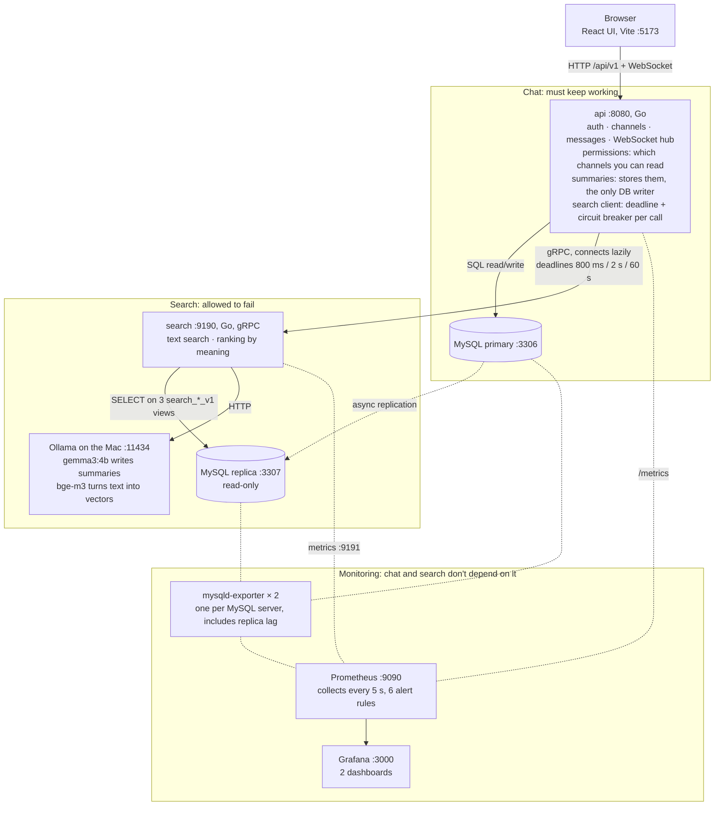

# MNChat

Multi-tenant team chat, like Slack: orgs, workspaces, public and private channels, threads
and live updates over WebSocket. Search runs as a **separate service**, so if search dies,
chat keeps working.

- **Chat API:** Go, REST and WebSocket, MySQL 9 primary
- **Search service:** Go, gRPC, reads a MySQL replica, AI through local Ollama
- **UI:** React with Vite
- **Monitoring:** Prometheus collects metrics from every service and both MySQL servers, and
  Grafana shows them

Design: [docs/design.md](docs/design.md) · Task board: [docs/tasks/README.md](docs/tasks/README.md) ·
Contracts: [docs/tasks/CONTRACTS.md](docs/tasks/CONTRACTS.md) · Test results:
[docs/tasks/VERIFIED-FACTS.md](docs/tasks/VERIFIED-FACTS.md)

## Architecture



Solid arrows are requests. Dotted lines are replication and metrics collection. Stopping anything in
the Search or Monitoring boxes leaves chat working.

What keeps chat safe from search:

- `api` never needs `search` to start, and `/api/v1/readyz` checks only the primary.
- Every call to `search` has a deadline and its own circuit breaker. An open breaker fails in
  milliseconds without touching the network.
- Replication is asynchronous, so a slow or dead replica never slows down chat writes.
- `search` connects with a user that can only `SELECT` from three `search_*_v1` views.
- Chat code and search code can't import each other. `internal/archtest` enforces it.

## How a request flows

**Text search (Messages tab)**
1. `api` checks you're in the workspace and lists the channels you can read.
2. `search` runs a MySQL `FULLTEXT` query on the replica, limited to those channels, and
   returns message IDs.
3. `api` loads the messages from the primary and checks access again before returning them.

**Summary (the [Summary] button on a thread)**
1. `api` checks access. If a stored summary already covers the newest reply, it's returned
   at once, even with `search` down.
2. Otherwise `search` reads the thread from the replica. `gemma3:4b` writes a 2–3 sentence
   summary, and `bge-m3` turns it into a 1024-number vector.
3. `api` stores both on the primary, and replication copies them to the replica.

**Search by meaning (Threads tab)**
1. `api` lists the channels you can read, as for text search.
2. `search` turns your question into a vector, compares it with the vectors of summarized
   threads in those channels, and returns the closest ones.
3. `api` loads the threads and their summaries from the primary and checks access again.

When `search`, the replica or Ollama is down, search returns `503` and the UI shows "Search is
temporarily unavailable. Chat still works."

## Project shape

| Path | What it is |
|---|---|
| `cmd/mnchat`, `internal/{httpapi,service,repo,realtime}` | Chat API: REST, WebSocket, permissions, summaries |
| `internal/searchclient` | Chat's gRPC client, with a deadline and a breaker per call |
| `cmd/mnchat-search`, `internal/search/*` | Search service: text search, Ollama client, ranking by meaning |
| `proto/`, `gen/` | The gRPC contract between the two services |
| `internal/archtest` | Test that keeps chat and search code apart |
| `internal/platform/metrics` | Prometheus metrics, served at `/metrics` |
| `internal/infra/mysqldb/migrations` | Schema and demo seed, applied when `api` starts |
| `deploy/mysql` | Replication config and init scripts |
| `deploy/observability` | Prometheus config and Grafana provisioning |
| `web/` | React UI: chat, thread panel with [Summary], search panel with Messages and Threads tabs |
| `docs/tasks/` | Task board, contracts, test results, one file per task |

## How to use it

**Prerequisites:** Docker with `docker-compose`, Go, Node, and the [Ollama](https://ollama.com)
app running on the Mac. Ollama runs natively, not in Docker, so it can use the GPU.

```bash
make models   # once: pulls gemma3:4b and bge-m3, about 4.6 GB
make up       # mysql, mysql-replica, api, search, Prometheus, Grafana, 2 MySQL exporters
make web      # UI at http://localhost:5173
```

| URL | What |
|---|---|
| http://localhost:5173 | The app |
| http://localhost:8080/api/v1/readyz | Chat API health, which checks only the primary |
| http://localhost:9090/targets | Prometheus: every service it collects metrics from |
| http://localhost:3000 | Grafana, no login needed |

To run the Go services natively instead: `make db`, then `make search` and `make api` in two
terminals.

| Command | Does |
|---|---|
| `make test` | `go vet` and unit tests |
| `make load` | k6 chat load in Docker, 5 users for 60 s. Fails on any chat error (`VUS=`, `DURATION=` to change) |
| `make chaos-search` | Stops search, then kills the replica, under chat load. Fails if chat returns a single error |
| `make replica-status` | Replication health |
| `make reset-db` | Wipes all data. The next `api` start applies the migrations and seed again |
| `make down` | Stops the containers |

**Demo users:** pick one on the login page, no password.

| User | Org | Notes |
|---|---|---|
| Alice Chen, Bob Martin | Acme HQ | The only members of the private `#leadership` |
| Carol Diaz | Acme HQ and Globex Labs | Can switch workspaces. Not in `#leadership` |
| Dave Kim | Acme HQ | Not in `#leadership` |
| Erin Walsh | Globex Labs | Sees nothing from Acme |

Everyone in a workspace can read its public channels: `#general`, `#random` and `#engineering`
in Acme, `#general` and `#research` in Globex. Only members can read a private channel.

The seed has six threads with 3 or more replies, so [Summary] shows on each: the welcome
thread, a website outage and rollback, a late vendor invoice and the October cloud bill (all
in `#general`), team lunch in `#random`, and a confidential Support restructuring in
`#leadership`.

## Demo walkthrough

1. **Summary.** Log in as Alice. In `#general`, open the thread "Incident update: the website
   went down…" and click **[Summary]**. Click it again: it comes back instantly from the stored
   summary. Do the same on the other seeded threads, because only summarized threads can be found
   by meaning.
2. **Text vs meaning.** Search `rolled back`. The **Messages** tab finds nothing, because text
   search matches words, and the thread says "roll back" and "Rollback". Switch to **Threads**:
   the outage thread comes first. Try `are we over budget on cloud costs` too.
3. **Permissions.** In a second tab, log in as Carol and search `reorganize the support team`
   in Threads. The `#leadership` thread never appears, because chat checks permissions before
   and after search.
4. **Live updates and stale summaries.** With Alice viewing the summarized welcome thread,
   reply in it as Carol. Alice sees the reply arrive, and an **Update summary** button appears
   under the summary, because it no longer covers the newest reply.
5. **Search dies, chat lives.** Run `docker-compose stop search`. Chat still sends and receives,
   stored summaries still open, and the search panel says "Search is temporarily unavailable.
   Chat still works." Run `docker-compose start search`, and search works again within about
   10 s, with no restart of chat. `docker-compose stop mysql-replica` gives the same result, and
   messages sent meanwhile become searchable once it's back.
6. **Prove it under load.** Open Grafana at http://localhost:3000 on **MNChat Overview** and run
   `make chaos-search`. While search and then the replica go down, chat requests, errors and
   latency stay flat, Services turns search and the replica red, the breakers open, and the
   alerts fire. **MNChat Search Pipeline** shows the breaker timeline and replication. The run
   ends with a pass or fail verdict on chat errors. The default run lasts a minute, so alerts
   only reach pending. To see them fire, give the outage about 3 minutes:
   `LOAD_SECONDS=270 SEARCH_DOWN_AT=20 REPLICA_DOWN_AT=130 RESTORE_AT=215 make chaos-search`.

**Before a live demo:**
- Run `make reset-db`, then `make up`, for clean seed data.
- Run one search in the Threads tab so the embedding model is loaded.
- Read each summary once, since a small local model can get details wrong.

## Kubernetes with k3s (planned)

> **Not built yet.** The repo has no Kubernetes manifests, so `make up`, with Docker Compose, is
> how to run MNChat today. This section is the plan for `deploy/k8s/`.

**Where k3s runs.** k3s runs only on Linux, so on a Mac it runs inside a VM. Colima, which
already runs Docker for Compose, has k3s built in, so there's no second VM, and images built with
`docker build` stay in the same VM. Turning it on restarts the Colima VM once, which stops every
running container, including other projects'. To avoid the restart, k3d runs k3s inside Docker
instead, but images then have to be copied in with `k3d image import`. minikube would run a
second Docker inside Colima, which costs the most disk and adds a network hop on the way to
Ollama.

**How Compose maps to Kubernetes**, all in namespace `mnchat`:

| Compose service | Kubernetes | Notes |
|---|---|---|
| `mysql`, `mysql-replica` | A StatefulSet each, with a persistent volume, and Services with the same names | The replica's init script connects to `SOURCE_HOST='mysql'`, so the names must match. The init SQL in `deploy/mysql/` becomes ConfigMaps |
| `api` | Deployment and Service on 8080, with `JWT_SECRET` in a Secret | Readiness probe on `/api/v1/readyz`, which checks only the primary. **One replica**, see the limits below |
| `search` | Deployment and Service on 9190 and 9191 | Stateless, so it can run several replicas. Reaches Ollama on the Mac through `hostAliases`: `host.docker.internal` at `192.168.5.2`, the address the Compose containers use |
| Exporters, Prometheus, Grafana | Deployments and Services, with `deploy/observability/` as ConfigMaps | `prometheus.yml` works unchanged, because the Service names match the Compose names |
| The UI | Unchanged: `make web` on the Mac | Vite's `/api` proxy targets `localhost:8080`, which a port-forward serves |

**Running it**, once `deploy/k8s/` exists:

```bash
colima stop && colima start --kubernetes --cpu 4 --memory 8   # once: restarts the VM, stops every container
kubectl config use-context colima
docker build -t mnchat-api:dev . && docker build -t mnchat-search:dev -f Dockerfile.search .
kubectl apply -k deploy/k8s                       # kustomize is built into kubectl
kubectl -n mnchat wait --for=condition=available deploy --all --timeout=180s
kubectl -n mnchat port-forward svc/api 8080:8080 &
kubectl -n mnchat port-forward svc/grafana 3000:3000 &
make web
```

Colima disables Traefik by default, so there's no ingress, and port-forwarding stands in for it.
To remove everything, run `kubectl delete -k deploy/k8s`. `colima kubernetes stop` stops k3s and
leaves Docker running.

**Limits to fix before running more than one `api` pod:**
- **WebSocket fan-out is in memory.** The hub in `internal/realtime/hub.go` only reaches browsers
  connected to the same pod, so with two `api` pods, half the users would miss live messages.
  Scaling chat needs a shared pub/sub such as Redis or NATS. `search` can scale today.
- **Migrations run when `api` starts.** Several pods starting at once would race, so migrations
  would move to a Job or an init container.
- **`make chaos-search` speaks Compose.** On Kubernetes, stopping search becomes
  `kubectl -n mnchat scale deploy/search --replicas=0`, and killing the replica becomes
  `kubectl -n mnchat delete pod mysql-replica-0`, after which the StatefulSet brings it back by itself.

**To verify first:** that pods reach Ollama at `192.168.5.2`, which works from Compose
containers, and that Colima's k3s runs locally built images without a registry, using
`imagePullPolicy: Never`.
